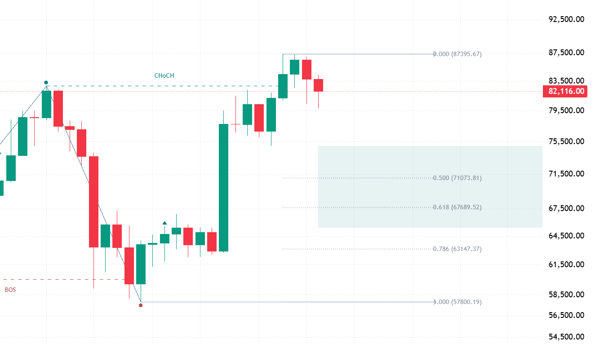
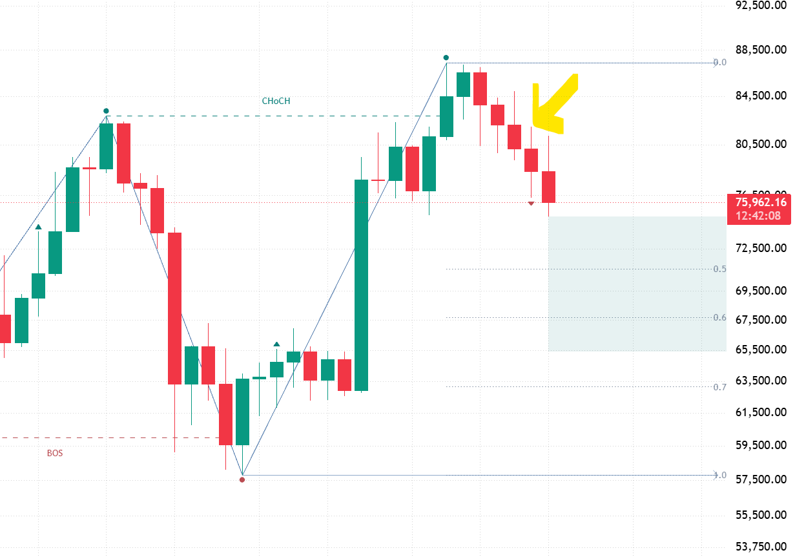
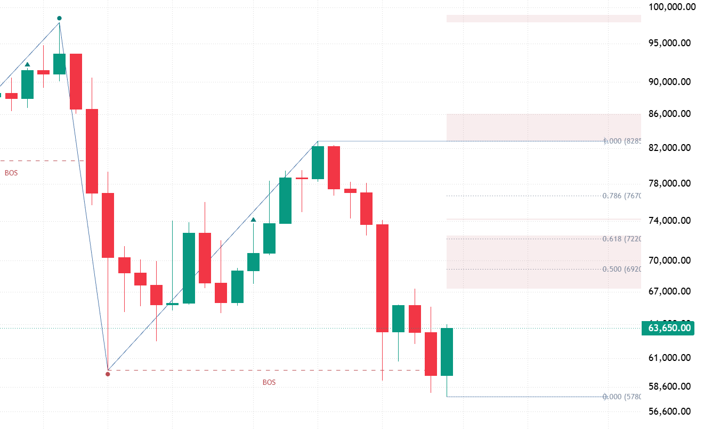
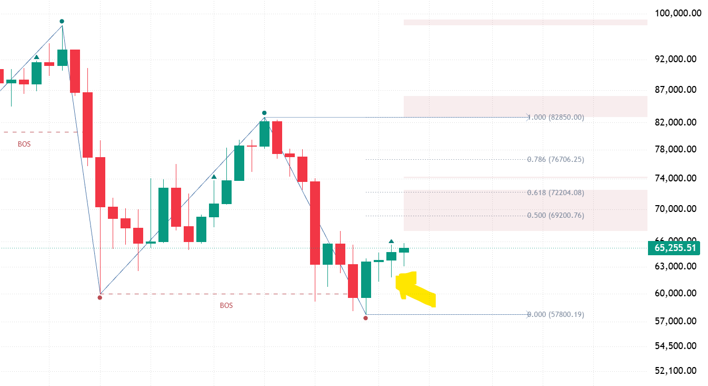
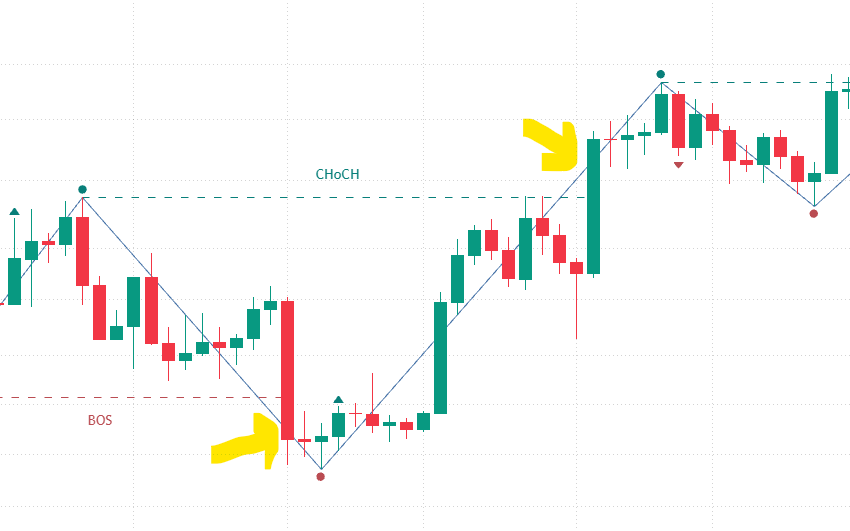
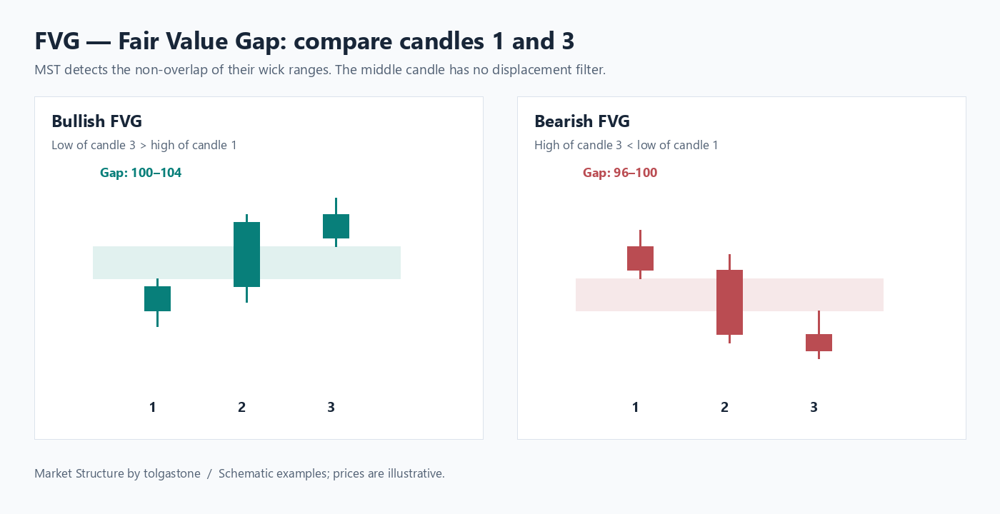

# Cement and the structure behind MST

Cement is the foundation of MST. It gives impulse completion a precise candle-based definition, while reference swing boundaries define the structural breaks. The distinction is easiest to see in the swing itself: the price extreme occurs first; opposite Cement can confirm it later.

## The Cement rule

With lookback 1, bullish Cement closes strictly above the previous candle's high; bearish Cement closes strictly below the previous candle's low. Candle body color does not define the rule, and equality does not qualify.

With lookback N, the close must exceed every high or fall below every low of the preceding N candles. For example, preceding highs of 100, 103 and 101 require a bullish close strictly above 103. N does not mean N consecutive Cement candles.

## An upward CHoCH impulse: provisional, then completed

### Before bearish Cement

The upward break of the reference high has already produced CHoCH. The working UP swing is still provisional: the engine tracks its high, and its working boundaries and Fibonacci context follow the tracked endpoints. A pullback or a red candle alone does not complete the swing.

The candidate high is not yet a completed swing endpoint. The working swing exists in the calculation, but the completed rising swing segment and high circle have not yet been drawn.

### Bearish Cement completes the upward swing

The yellow arrow identifies the bearish Cement candle. When its close is below the required preceding low, the normal completion condition is met. The swing is drawn to the tracked high, and the high is marked at the bar where that extreme occurred.

This is the difference between an evolving high and a completed structural high. The high bar and the completion bar are different moments: the line reaches back to the extreme, while completion becomes known later. The pullback is now visible as the move following that completed upward impulse; it is not by itself a new downward CHoCH.

## A downward BOS impulse: the mirrored sequence

### Before bullish Cement

Here the reference low has been broken in the downward direction, producing BOS. The DOWN impulse continues to track its low. A green candle alone does not complete it; opposite Cement is required for normal completion.

The working low and its display context can update while the impulse remains unfinished. The completed falling segment and low marker are not yet drawn for that impulse.

### Bullish Cement completes the downward swing

In the next view, the highlighted bullish Cement closes above the required preceding high. The tracked low becomes the endpoint of the completed DOWN swing. The low circle is placed on the earlier extreme bar, not on the later Cement candle.

The upward correction follows that completed downward impulse. A bullish Cement completing a DOWN swing is not automatically an upward CHoCH; CHoCH still requires the appropriate reference-boundary break.

## BOS and CHoCH belong to the reference swing

The terms describe a break relative to the reference direction:

- **BOS — Break of Structure:** a break in the reference swing's direction.
- **CHoCH — Change of Character:** a break against the reference swing's direction.

The arrows below point to the actual break candles. The lower arrow marks the candle breaking the reference low for a downward BOS. The upper arrow marks the candle breaking the reference high for an upward CHoCH.

The dashed line starts at the reference extreme and ends at the break candle. The text is centered along that line for readability: the word BOS or CHoCH is not positioned at the event time.

Close mode uses the current close; High/Low mode uses wick extremes. In both cases a strict break is required. The labels describe the structural relationship, not a guarantee about the next price move.

## Two roles, one structural sequence

**Boundary break → track the impulse extreme → opposite Cement → completed swing.**

Cement is central to how MST forms its swings, but it does not replace the boundary break as the normal impulse trigger. The first Cement also establishes initial direction before a mature reference exists. An opposite-boundary break can interrupt an impulse before Cement completion; see [The MST approach](ALGORITHM.md) for that path and same-bar ordering.

The examples show the normal opposite-Cement completion path. Cement markers are emitted by the structural engine; they do not mark every qualifying candle.

## FVG: Fair Value Gap

MST detects non-overlap between the wick ranges of candles 1 and 3:

- **Bullish FVG:** candle 3's low is above candle 1's high.
- **Bearish FVG:** candle 3's high is below candle 1's low.

On the left, the gap is 100–104; on the right, it is 96–100. The middle candle can trade through that interval. MST does not require a particular middle-candle body or displacement threshold.

Later candle ranges are subtracted from stored gaps: full coverage removes a fragment, partial coverage trims it, and an interior range can split it into two remaining pieces. This is not a first-touch-filled rule.

The diagram shades the formation interval for explanation. On the actual MST chart, surviving boxes extend from the current bar to the right and are filtered by the reference swing's display range. They are not historical origin boxes.

## Chart position and confirmation time

The closed Cement candle provides the final close-based predicate described above. The script also evaluates on open-bar updates, so provisional results can appear or change before close; it does not enforce close-only processing. These chart excerpts explain the sequence rather than record every intrabar update.

Swings, extreme points, BOS/CHoCH, working boundaries and Swing Zones are visible by default in v1.1.0. The [Swing Zones guide](SWING_ZONES.md) explains OTE, Premium/Discount and Equilibrium. Enable Cement markers and FVG fragments in settings to study the optional layers. See the [usage guide](USAGE.md) and [parameter reference](PARAMETERS.md).
