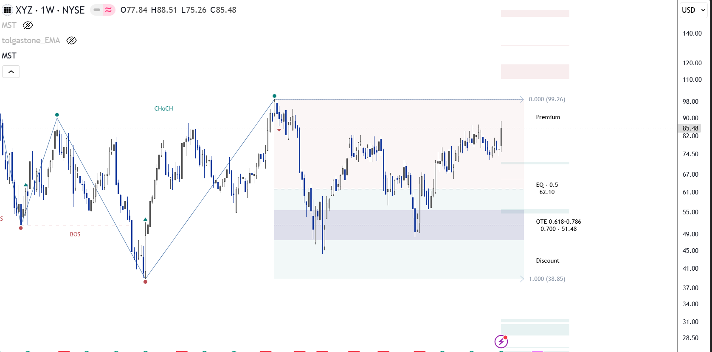
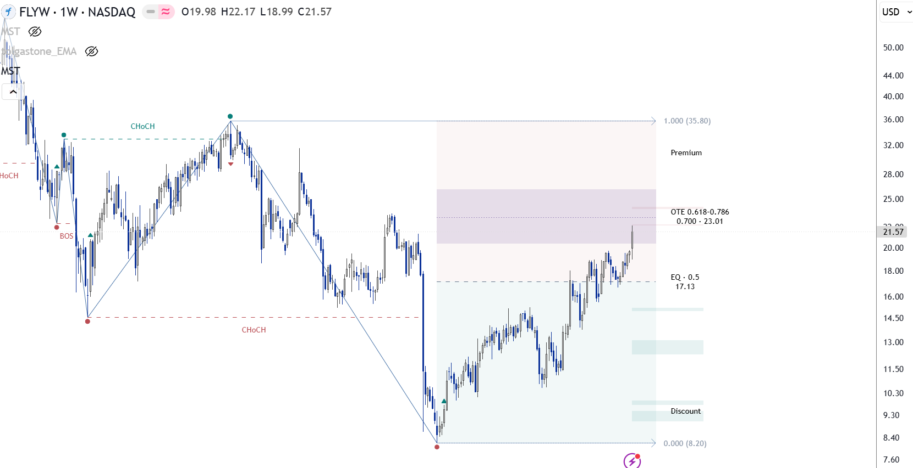
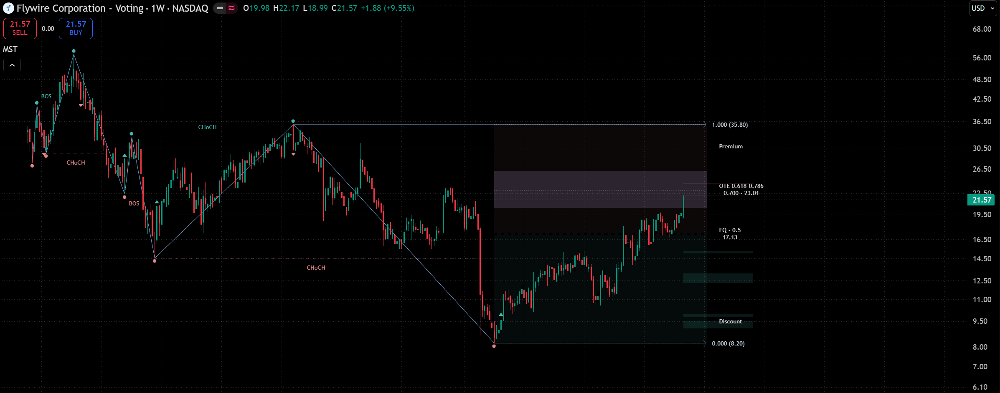

# Swing Zones — v1.1 release candidate

Swing Zones is a display layer for the existing working swing. It does not change reference-boundary breaks, Cement, swing construction or FVG maintenance. The release candidate has passed the reviewed TradingView compilation and visual checks. It has not replaced the published v1.0.0 release.

## Three independent layers

- **Premium / Discount:** very subtle fills above and below the logarithmic 0.5 price. Premium always means the higher-price half and Discount the lower-price half, regardless of swing direction.
- **Equilibrium:** a thin dashed line and `EQ · 0.5` label at the geometric midpoint `sqrt(H * L)`.
- **OTE:** a stronger, direction-independent purple band between logarithmic ratios 0.618 and 0.786. It lies in Discount for an UP swing and Premium for a DOWN swing. Its optional dotted reference is Off, 0.700 or 0.705.

All three layers default to visible; the reference defaults to 0.700. The fills remain subtle on light and dark backgrounds. Auto follows the existing palette; Custom uses the new fill and equilibrium colors. These are analytical regions, not trade-entry instructions.

## Anchors and availability

The layer follows `currentSwing`, like the existing Fibonacci display. Regions span from its directional extreme bar (high for UP, low for DOWN) to 10 bars beyond the current bar. Labels sit 12 bars ahead. The left edge is clipped to the drawing-safe recent bar-index window for very old anchors.

No historical zone archive is created. Only the current working swing is displayed. Its levels can change while the impulse extends or on open-bar updates. Normal Cement completion establishes the completed endpoints; those working endpoints remain in use until the engine changes the working swing. The layer does not impose a new confirmation policy.

Startup or invalid geometry produces no zones: direction and endpoints must exist, and `high > low > 0`. This drawing guard does not change structural initialization.

## Interaction with classic Fibonacci

Zones use fixed ratios, independently of the eight editable classic Fibonacci ratios and the Show Fibonacci levels switch. Zones remain visible if classic Fibonacci is hidden.

To avoid duplicate annotations, visible EQ owns the 0.5 level; visible OTE owns 0.618/0.786 and the selected enabled reference. Matching classic levels are temporarily omitted from the displayed array. Ratios 0 and 1 remain available in the classic layer. Disabling the corresponding zone annotation restores its matching classic levels, subject to their existing Enable switches. No input ratio is modified.

Each layer can be switched off independently. Premium/Discount still uses the midpoint internally when the separate EQ line is hidden. OTE reference Off hides only its dotted line and reference-price text, not the band.

## Drawing lifecycle

At most three boxes, two lines and four labels are held for this layer. Existing objects are moved and recolored; disabled or invalid layers are deleted. Handles removed by platform garbage collection are recreated when needed. Other historical drawing budgets still apply.

## Chart examples

## Review scope

Compilation, UP/DOWN examples, light/dark display, independent layer switches and OTE reference Off/0.700/0.705 were checked during preparation. These checks do not constitute a full live timing or resource stress test.

Further regression coverage includes manually chosen Custom colors, classic Fibonacci matching-ratio restoration, anchor transitions, reload/replay and startup geometry. The structural engine was retained unchanged; comparisons should continue to use identical data and structural settings.
