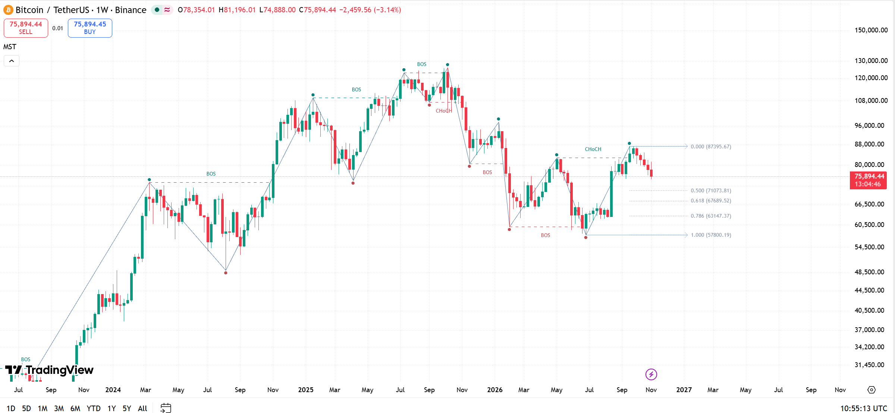
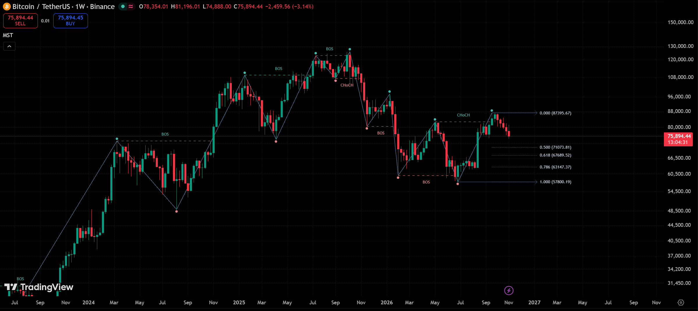
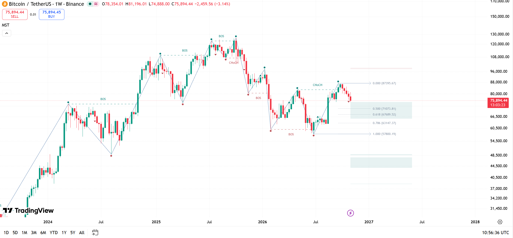
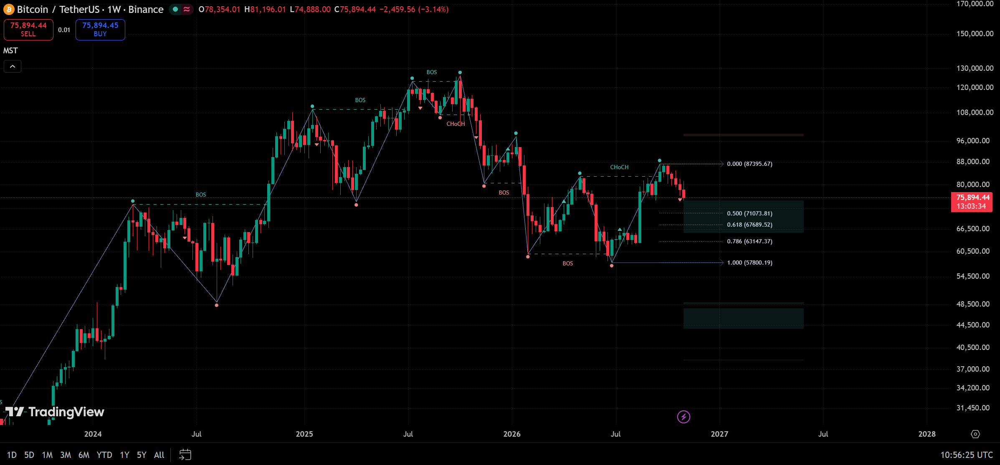

# Chart examples

**BINANCE:BTCUSDT · 1W · standard candles · UTC**. Break source: **Close**. Cement lookback: **1**. Color mode: **Auto**.

The following charts show the default layout and optional display layers on light and dark backgrounds.

## Default view

Swings, extreme circles, BOS/CHoCH, working boundaries and Fibonacci are shown. Optional ratios 0.5, 0.618 and 0.786 are enabled, in addition to fixed 0 and 1. Cement and FVG visibility are off.

## Optional Cement and FVG layers

The same structural settings with Cement markers and FVG fragments enabled. The chart framing differs from the default examples. FVG boxes extend from the current bar; they do not mark historical gap-origin positions.

The last weekly candle was open when these charts were captured. Its price and provisional drawings can change before close.

## Swing completion and break candles

The [illustrated concepts guide](../docs/CONCEPTS.md) walks through upward and downward impulse completion using the following chart excerpts. Yellow arrows identify the relevant Cement or break candles. The excerpts are cropped and have no full time axis; use them to read the structural sequence, not to infer exact event dates or intrabar availability.

- [UP impulse before Cement](swing-up-before-cement.png) and [after bearish Cement](swing-up-after-cement.png).
- [DOWN impulse before Cement](swing-down-before-cement.png) and [after bullish Cement](swing-down-after-cement.png).
- [Actual BOS/CHoCH break candles](break-candles.png).
